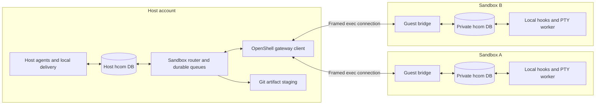

# Design

## Context

See [proposal.md](proposal.md) for motivation and the three capability deltas for the behavioral contract. This is a researched design, not an implemented or live-qualified integration.

The original research used this hcom checkout, Git objects at its recorded upstream base, the then-current OpenShell checkout, and primary OpenShell documentation.

The local VM evaluation now points to `OpenShell-v0.1.7` at `5d25211b25a8fc887e8d5c606d57d6ab22f1d76c`, with a recorded downstream VM generation fix. The older `OpenShell-current` path has been retired. The local evaluation has separate v0.1.7 CLI and gateway binaries; PATH still selects v0.1.3. Use the evaluation binaries as the candidate and record their hashes, source and local diff, and live gateway identity before relying on the October transport assumptions.

### Evidence and resulting constraints

| Evidence checked on 2026-10-23 | Consequence |
| --- | --- |
| hcom HEAD `d04da5f`; `docs/fork-patches.json` records upstream `de33e31a0cdbba4c5863f7cc050d8b79aa50bcdf` | Use that exact base for the first portability trial; this is not a claim about current upstream HEAD. |
| `src/commands/launch.rs` and `src/launcher.rs` have stable upstream launch boundaries; `LaunchBackend` distinguishes visible PTY, headless PTY, and native print hosting | Add execution location orthogonally; do not replace backend or tool abstractions. Dispatch sandbox selection before host tool validation/configuration. |
| `src/integration_spec.rs` already assigns `--sandbox` to several tools | Reserve `--hcom-sandbox <profile>` and `--hcom-sandbox-source <commit>` for hcom. Test `--` and value forwarding. |
| `src/launcher.rs::build_launch_env_with_resolver` inherits ambient shell environment and hcom env extras | Never send its host result wholesale to a guest. Resolve guest settings from an explicit profile. |
| `src/commands/send.rs`, `src/messages.rs`, and `src/db/events.rs` implement routing, envelopes, inbox cursors, and generation keys | Reuse their local behavior through narrow adapters. The bridge observes its own queues, not the agent inbox cursor. |
| `src/commands/events/result.rs::apply_result_correlation` accepts the expected generation's `inform` in a thread | Sandbox result waits need an explicit final marker and request identity; ordinary informs retain their existing behavior. |
| `src/instances.rs` treats any `origin_device_id` as remote; `src/instance_lifecycle.rs` deletes stale remote rows using MQTT sync keys | Foreign-instance projection can be reused only with explicit transport classification and sandbox-owned cleanup. Setting the origin field alone is incorrect. |
| `SECURITY.md` documents all-or-nothing PSK relay authority; `src/relay/control.rs` exposes launch, kill, config, terminal, events, and subscription RPCs | Guests must not join the trusted relay. Capability advertisements are not authorization. |
| `src/relay/push.rs` exports local state and may shrink oversized events; its exclusions do not describe a sandbox team | Explicitly exclude sandbox-scoped events from MQTT export. Do not use snapshot shrink/backfill as the durable result transport. |
| `src/commands/events/{observation,result}.rs` and `src/db/fork_schema.rs` do not exist at the recorded upstream base | Keep fork progress/result adapters separate. The new core must not depend on these files or the approval-owner extension. |
| OpenShell checkout `a24340bebaa9ee173725ce87c48011d2cc2cacd9` has an existing local VM-driver modification | Preserve that work. No OpenShell changes are included here. |
| PATH CLI reports `0.1.3`; checkout CLI and gateway report `0.1.6-pre.1` | Store the absolute executable and gateway identity in the profile; probe behavior, not just semver. |
| `crates/openshell-cli/src/run.rs` streams open piped stdin after a 200 ms grace and caps cumulative piped input at 4 MiB | A persistent exec bridge needs controlled rotation below that limit. EOF is not permission to discard pending output. |
| `run.rs::sandbox_exec_streaming_grpc` writes and flushes stdout/stderr chunks, keeps reading after Exit, and fails on missing Exit or failed final status; sandbox overview documents slow-reader backpressure and output-drain failure | Guest-to-host output is a streamed, backpressured direction, not the 4 MiB stdin allowance. Concurrent draining, bounded application credit, slow-reader recovery, and final-status checks need their own live qualification. |
| `src/delivery.rs::inject_text` strips C0 controls except tab but permits characters above that range; wake previews use sanitized metadata | Do not claim complete terminal-control safety from the PTY helper. Validate guest text and identifiers before any inbox/rendering path, including C1 and DEL rejection. |
| OpenShell sandbox overview rejects creation-time `--upload` with a main command | Create a retained scratch sandbox, transfer inputs, then launch the detached guest worker. Sandbox main-process attachment is not the worker's PTY. |
| OpenShell runtime docs select one compute driver per gateway; VM binds have additional host exposure | A profile selects and verifies a gateway with the intended driver. The reference profile has no host bind mounts. |
| Runtime docs state that VM `--cpu`/`--memory` requests do not change allocation | Qualify the gateway's VM `vcpus`/`mem_mib` configuration; passing generic create flags is not evidence of resource enforcement. |
| OpenShell provider profiles bind credentials to endpoints; no-login exec still needs a controlled environment | Attach explicit provider instances, including custom endpoint profiles when needed; clear shell startup injection variables for managed bridge exec. |

Primary references, checked alongside the local source:

- [Sandbox exec, input limits, upload, and lifecycle](https://github.com/NVIDIA/OpenShell/blob/a24340bebaa9ee173725ce87c48011d2cc2cacd9/docs/how-it-works/sandboxes/overview.mdx); [current upstream documentation](https://github.com/NVIDIA/OpenShell/blob/main/docs/how-it-works/sandboxes/overview.mdx).
- [Runtime selection and VM mount limitations](https://github.com/NVIDIA/OpenShell/blob/a24340bebaa9ee173725ce87c48011d2cc2cacd9/docs/how-it-works/sandboxes/runtimes.mdx).
- [Provider endpoint binding](https://github.com/NVIDIA/OpenShell/blob/a24340bebaa9ee173725ce87c48011d2cc2cacd9/docs/how-it-works/providers/profiles.mdx).

Graph coverage checks reported no recorded gaps for the source paths above. The October research checked CLI versions, help, and source. The November preflight below adds live fixture evidence.

### Runtime preflight on 2026-11-21

- A disposable loopback gateway used the OpenShell 0.1.7 VM evaluation build and Ubuntu fixture image `nvcr.io/nvidia/base/ubuntu@sha256:fef8f2708dbb85fbfcba6503d805397d89d9210f375362ff3b9f7888eb297ca5`. Two guests kept different values written at the same path. A detached guest command completed after its launching exec closed, and a later exec read the result.
- Exec consumed 2 MiB of piped stdin, and a 5 MiB attempt returned the explicit 4 MiB limit. One exec delivered 4.5 MiB of stdout while consuming 2 MiB of stdin. The first large-output fixture hit the guest policy on `/dev/zero`; the repeat generated text under the same policy and passed.
- All disposable sandbox IDs reached absence and both gateways stopped. The local evidence directory `~/.local/state/hcom/openshell-preflight-0e8k2m_4/` contains the binary fingerprints, runtime patch, fixture results, and logs. The probe used shell fixtures. Bridge replay, Claude/Hermes readiness, and Z.ai egress remain covered by their later qualification tasks.

## Goals / Non-Goals

**Goals:** Keep normal hcom conversations and local tool delivery across an execution boundary; make accepted traffic and results survive bridge failures; enforce guest scope independently of guest honesty; give upstream ports a small, identifiable adapter surface.

**Non-Goals:** No general remote-execution framework, scheduler, new agent language, custom OpenShell compute driver, or replacement for Git. No initial guarantee for desktop-backed Antigravity, Windows/macOS hosts, every CLI provider, multi-worker guests, uncommitted snapshot capture, or remote MQTT-to-sandbox forwarding. See the proposal for the release scope.

## Decisions

### 1. Host-owned router, private guest hcom, one worker per sandbox

The router is ordinary host code, not a coordinating model. Each guest runs the same qualified hcom bridge protocol plus an existing local CLI/PTY integration against a private `HCOM_DIR`. The host owns team membership, canonical aliases, routing identities, and lifecycle records.

A sandbox launch batch creates a fresh team containing the explicitly resolved host requester and that batch's workers. Host-only team management can enroll additional host agents, and `--hcom-sandbox-team <id>` can place a later batch into an existing authorized team. An external launcher without a host agent identity receives a controller handle rather than an invented host-agent identity. Tags and thread names are routing conveniences, not authorization credentials. Guests cannot enroll peers or expand a team by naming a new target.



The gateway authenticates host-initiated connections. No host listener, MQTT PSK, or gateway client credential is provided to guests. A compromised guest can corrupt its own reports or send authorized team messages; it cannot turn a frame into a host control request. Messaging still exposes host agents to untrusted peer content, so attribution and existing host execution permissions remain necessary.

**Alternative:** Shared host `HCOM_DIR` or trusted relay enrollment is simpler to connect but grants filesystem or control authority beyond messaging. A newly exposed network broker would require another authentication/authorization surface. Neither is needed for the first mode.

### 2. Separate location selection from guest tool behavior

Proposed launch surface:

```sh
hcom claude --hcom-sandbox coding --headless --dir /path/to/repo --go
```

`coding` is an operator-owned entry in `$HCOM_DIR/sandbox-profiles.toml`. It references an absolute OpenShell executable, gateway and workspace, expected driver, pinned image, policy file, provider names, explicit non-secret env, repository input policy, resource/timeout bounds, and guest unattended tool arguments. Store identifiers and digests in run records; never embed provider secrets in the profile or CLI arguments.

Host launch parsing validates combinations before tool-specific host preparation. Sandbox mode removes its own options, serializes raw tool arguments, and asks guest hcom to perform normal tool setup at guest paths. The bridge uses absolute executable paths and argument vectors; no guest data is interpolated into host shell commands. Host env files, terminal context, and host trust settings are not guest defaults.

The reference tool uses Claude Code's existing live PTY mode for headless launches. The reference profile sets GLM 5.3 Flash through Z.ai for primary and auxiliary inference, attaches the Z.ai credential through an explicit provider reference, and denies Anthropic API egress. Provider failure is surfaced to the requester. This provider and model default applies only to the sandbox profile. A qualified profile supplies its guest-only unattended permission setting. OpenShell policy proposal approval remains operator-controlled.

### CLI qualification

| CLI | Qualification case |
| --- | --- |
| Claude Code | First guest worker, with the Z.ai-only GLM reference profile. |
| Codex | Qualify its own guest runtime, provider, permissions, and hcom delivery. |
| Oh My Pi (OMP) | Qualify its own guest configuration, provider, and hcom delivery. |
| OpenCode | Qualify its own guest profile, provider, and hcom delivery. |
| Hermes | First qualify an ordinary local Hermes session as host requester, using its existing identity and delivery. Then qualify Hermes as a worker with a fresh guest profile and private state. |

Each guest profile references an image with the required CLI version and dependencies. Reuse an image when it satisfies the profile and passes that CLI's qualification. Each worker receives its own writable VM, repository, tool state, and hcom state even when the workers use the same image. Keep checkout inputs and credentials outside the reusable image.

Guest roles do not start the host sandbox router or trusted relay worker. The role marker is a behavior setting, not a security credential. Unsupported desktop/nested/cross-device combinations fail before provisioning; adding another tool or runtime requires a bounded qualification record.

The first release requires `--headless` and rejects visible launch, `--run-here`, and explicit `--terminal` options before provisioning. Existing configured host terminal preferences are not applied to a guest. A count of N creates N independently owned sandboxes in one team, with per-worker success/failure handles and retention of partial provisioning evidence. A later visible attach implementation needs its own qualification; observation does not imply interactive launch support.

**Alternative:** A `hcom run` wrapper can prototype transfers but cannot transparently integrate names, inboxes, lifecycle, and authorization. Replacing `LaunchBackend` with a sandbox variant conflates location with PTY/print hosting.

### 3. Bootstrap a scratch sandbox, then a detached worker

Preflight verifies executable capabilities, gateway identity and driver, effective policy, image availability, required guest hcom/tool versions, and provider bindings. Explicit providers and disabled automatic credential discovery avoid copying host credentials. Refuse bind mounts in the reference profile. Keep the configured gateway's normal authenticated TLS checks.

For source input, create a Git bundle for the selected base and its reachable prerequisite history, not all refs or a copy of `.git`. Clone it inside the guest with fresh configuration and hooks. That history is part of the selected repository input; omit unrelated refs, worktree metadata, remotes with credentials, host hooks, and Git config. Dirty or untracked local work requires explicit `--hcom-sandbox-source <commit>` acknowledgment of committed-only input. Capturing dirty work is not implemented by this first mode.

Create a retained detached scratch sandbox without a workload main command or automatic deletion. Upload inputs to a fixed staging area and initialize the snapshot before starting the worker with guest hcom's detached PTY launch. Use `sandbox exec --no-tty --no-login-shell` for managed commands, with controlled env including `BASH_ENV` and `ENV` neutralization. Agent and bridge state live outside the mutable repository snapshot. Guest process detachment and survival across exec disconnect are a mandatory live qualification gate, not an assumption based on Ready status.

Readiness progresses through `provisioned`, `inputs-ready`, `bridge-ready`, and `agent-ready`. A ready scratch shell is not a ready agent. Failures retain the captured sandbox ID, phase, command outcome, and bounded logs. The bridge exec process is not the worker supervisor: rotating it must not recreate the worker.

### 4. Use framed exec with durable replay and connection rotation

Use the OpenShell CLI as the initial transport adapter. This keeps OpenShell's Rust SDK and its dependency tree out of hcom and permits capability probes against the selected executable. A raw SDK/SSH transport remains a future substitute behind the adapter if measured limits require it.

The host starts a fixed guest bridge command over non-TTY exec. Stdout contains only length-delimited versioned JSON frames; stderr is bounded diagnostics. The parser rejects oversized length headers before allocation, malformed frames, unsupported protocol versions, unknown kinds, invalid UTF-8/field types, and unexpected identities.

Protocol kinds cover handshake/directory snapshots, outbound message requests, routed inbox messages, durable acceptance, observed delivery receipts, bounded activity, result submissions, and connection close. No generic RPC, SQL, shell command, file-read, or host control frame exists. Each message carries a stable origin key, sequence, thread/reply references, payload digest, and host-issued location/team binding. Transport epoch is separate from message identity so reconnects can replay the same message.

Initial implementation defaults: maximum encoded frame 256 KiB, conservative host-to-guest exec rotation at 2 MiB including framing and acknowledgments, and a bounded connection lifetime. The 4 MiB source observation is not a runtime capability API. A qualification probe records the actual input allowance for the exact CLI/gateway/runtime fingerprint; preflight requires that qualified record to match. Unknown allowances or an allowance below 2 MiB plus a maximum frame and reserved control margin fail qualification. The recorded allowance feeds the byte guard; it must never be inferred from semver alone.

The configured rotation point (initially 2 MiB) is the guard threshold: rotate before a new payload frame would cross it. The measured allowance is a separate upper safety bound with control/drain headroom, not a second competing rotation target. Oversized sandbox messages fail explicitly at the sender before queue acceptance, including a host sender whose normal local message limit is larger. Large evidence uses Git artifacts. Durable queue byte/count limits and expiry are explicit profile limits; an expired message emits terminal delivery failure instead of being silently dropped.

The Linux VM adapter uses an absolute OpenShell CLI, an explicit gateway name and endpoint, and a selected workspace. It checks the local registration before calling the gateway and probes access to the selected workspace. Its qualification record binds SHA-256 hashes of the CLI, gateway, VM driver, and operator-supplied gateway configuration to the reported gateway and driver versions. The configuration must explicitly set the VM allocation. The live gateway info confirms versions and driver identity. Binary and configuration hashes come from the local runtime artifacts, since gateway info exposes no remote digest or allocation. HTTPS uses the registered mTLS credentials, and the disposable plaintext fixture is restricted to an explicit loopback address. Managed exec uses non-TTY argv with login sourcing disabled and empty `BASH_ENV` and `ENV` values.

The disposable OpenShell 0.1.7 VM probe recorded its fingerprint and results in `~/.local/state/hcom/openshell-adapter-vwmwdv1k/`. Its driver ran with 3 vCPUs and 2,560 MiB, matching the test gateway configuration. Exec accepted 4,194,304 stdin bytes and rejected 4,194,305. The Rust adapter ran a managed command with contaminated host startup and OpenShell settings in the parent environment. The disposable VM was deleted and the fixture gateway was stopped. A failed setup in `~/.local/state/hcom/openshell-adapter-3vvlq2sp/` recorded the WSL Windows `mke2fs` shim lookup. The successful rerun put Linux e2fsprogs first on the fixture gateway's PATH. Qualifying a runtime requires a live check that exec accepts the empty guest startup variables with the adapter's scrubbed environment. The source and artifact transfers also require a live upload and download under the same controlled environment before enabling their respective paths.

Drain exec stdout continuously in a separate reader from the input writer. Guest-to-host frames have a bounded outstanding credit window; the host grants more credit only as its parser/admission path consumes them. Slow-reader tests must demonstrate bounded buffering, clean recovery, and no false acceptance. A stalled output or final-status drain closes/fences the connection at a bounded deadline and replays unacknowledged frames. Do not assume an unlimited or infallible output channel merely because its inspected loop has no cumulative-input-style counter.

The Unix transport advances independent nonblocking readers and writers in the same loop. Each direction starts with one payload slot. The receiver releases it by sending a receipt after commit, and the sender reuses it only after saving the matching receipt. Handshake, receipt, and close frames have separate write capacity. The host rotates before the next payload would cross 2 MiB or after five minutes. The measured stdin allowance covers control traffic as well as payload. The bridge uses 15-second handshake, frame, and receipt deadlines and starts the host clock after spawning the CLI. Close and final subprocess status share a five-second drain limit. A descendant that keeps an output pipe open past the deadline causes a transport failure and preserves pending traffic for replay. Stdout carries protocol frames. Stderr has a 64 KiB cap, with an escaped tail of up to 1 KiB of input included on failure.

The host exec driver can advance a route one step at a time. Each step checks deadlines and ownership, advances subprocess I/O and outbox state, and returns when it would need to wait. A fixture interleaves two routes against the same database and verifies one can commit a payload and finish its close handshake while the other child has produced no output. For an enrolled route, the adapter checks the gateway and workspace, then queries OpenShell for the captured sandbox ID, name, workspace, and Ready phase before starting exec. The lookup uses a three-second deadline. The pinned OpenShell 0.1.7 CLI resolves streaming exec again by workspace and name. Before sending the hello or directory, the host sends a fresh challenge and waits up to five seconds for an HMAC-SHA256 response that covers the route binding and connection epoch. The expected key is shared with the bound guest through its owner-only manifest. The bridge checks the guest's local worker generation before it answers. The key stays out of argv and the wire. Provisioning still needs to issue and retain a fresh key for every owned route, and the detached controller still needs to schedule forwarding.

A disposable OpenShell 0.1.7 Linux VM answered the startup challenge in 0.35 seconds while stdin remained open. The test harness verified the response, exchanged ordinary bridge frames through the same exec, and read one message using guest `hcom listen`. The fixture was deleted by captured ID and its gateway stopped. The evidence and harness are in `~/.local/state/hcom/openshell-proof-wh11xake/`. The first attempt failed before the proof because the gateway selected the WSL Windows `mke2fs` shim. The successful run put Linux e2fsprogs first in the fixture's PATH. The failed attempt is retained in `~/.local/state/hcom/openshell-proof-iyndsbja/`.

The internal guest entry point takes an explicit manifest with the private database path and expected binding. Its handshake checks the binding and database incarnation before claiming the epoch. Both ends check the persisted epoch within the import and receipt transactions, so a replaced connection cannot commit either operation. Guest imports currently stage a sandbox event in the private database. Ordinary inbox mapping and notification are added in task 3.2.

The live fixture uses the pinned 0.1.7 loopback gateway and Ubuntu 24.04 VM image from runtime preflight. It stages a copy of the hcom binary with its userspace loader and libraries because the host build uses Nix store paths. The opt-in `sandbox::bridge::live::vm_qualification` test reads `HCOM_BRIDGE_VM_FIXTURE` and runs the `prepare`, `exercise`, `interrupt`, and `restart` phases selected by `HCOM_BRIDGE_VM_PHASE`. The `interrupt` phase deliberately exits with status 75. It uses separate private databases for host input, reverse output, and lost-receipt replay. For the reverse burst, the host fixture raises the per-window pacing ceiling to 8 MiB while preserving connection credit and all other admission limits. The normal pacing ceiling is 1 MiB per ten seconds.

The successful fixture remeasured the stdin limit on that gateway configuration. It accepted 4,194,304 bytes and rejected 4,194,305. The bridge then carried 4,505,600 payload bytes in each direction. The host-to-guest run accepted 22 messages across two rotations against the measured 4 MiB stdin allowance. The guest-to-host run accepted 22 messages in one exec after a 500 ms host read stall. The host then committed a separate message, terminated the CLI before writing its receipt, and exited with its database and owner still open. The guest still had one pending message at epoch 7. A new host process reopened the database and waited for a replay at epoch 9 to queue its receipt before closing. The host kept one inbox row, and the harness verified that the guest saved the receipt. A separate overlap probe replaced epoch 1000 with 1001 while both exec invocations were open. The older process failed, issued no receipt, and added no inbox row. The fixture VM reached confirmed absence and the gateway stopped.

The run evidence and harness snapshot are in `~/.local/state/hcom/openshell-bridge-9fxkekbk/`. The earlier incomplete run in `~/.local/state/hcom/openshell-bridge-hdsru0ak/` omitted SQLite's WAL from its pre-restart snapshot. The successful reruns captured it and matched the guest epoch to the host's recorded disconnect epoch. The orderly host restart is recorded in `~/.local/state/hcom/openshell-bridge-vmulcrfd/`. The initial open-stdin handshake and its final status are recorded in `~/.local/state/hcom/openshell-bridge-2w2zi25p/`. The preceding setup failures are retained at `openshell-bridge-32a6p1k3/` and `openshell-bridge-ygp8tnrt/` under the same state directory.

### Detached worker fixture

The detachment trial reused the OpenShell 0.1.7 Linux VM binaries fingerprinted in the adapter trial and the Ubuntu 24.04 image resolved in the gateway log at digest `sha256:fef8f2708dbb85fbfcba6503d805397d89d9210f375362ff3b9f7888eb297ca5`. A disposable fixture started one heartbeat worker in a separate guest exec using `setsid`, with stdin redirected from `/dev/null` and both output streams redirected to a guest file. The VM stayed running as the actual hcom guest bridge closed cleanly at epoch 1, lost its host CLI with stdin open at epoch 2, and reopened and closed cleanly at epoch 3.

Guest PID 733 and its start-time ticks (545) matched before and after every interruption. Its progress counter advanced from 2 to 9, 16, and 22. The guest recorded one launch and found exactly one process with the fixture script in its argv at each check. The sandbox reached confirmed absence and the gateway stopped. Evidence and the launch script are in `~/.local/state/hcom/openshell-detached-yeome3pu/`.

This qualifies a detached non-agent process while the selected VM remains running. The Claude Code PTY bootstrap, unattended provider access, and guest worker readiness require their own launch checks. VM stop/start and restoration use the lifecycle qualification.

Admission also enforces per-guest pacing, finite per-run and per-team cumulative message-count/byte budgets, and a host-wide storage ceiling. These cover accepted inbox/history rows as well as pending queues; successful forwarding does not replenish a run's history budget. Bound activity/diagnostic storage separately and coalesce replaceable status. Persist counters in the same transaction as acceptance, so reconnect/restart cannot reset credit. Budget renewal is host-only. Reserve a small bounded control allowance for receipts/close/errors to avoid a payload-credit deadlock, and emit at most a bounded rejection diagnostic before fencing a flooding connection. Defaults are finite in the reference profile; an unlimited guest budget is invalid.

The core store defaults to 256 pending frames and 16 MiB of encoded pending traffic. Cumulative limits are 2,000 records and 32 MiB per run, 8,000 records and 128 MiB per team, and 32,000 records and 512 MiB per host database. These are logical admission charges for the encoded frame, its SQLite event data, and a fixed metadata allowance. They do not measure the physical size of SQLite pages or WAL. The guest ingress allowance is 32 frames and 1 MiB per run per ten-second window, using host time. A rejected write rolls back its quota use and event together. Replaying an already admitted frame returns its existing receipt without consuming another allowance.

Regression tests exercise the real send and host inbox transactions. JSON escaping can put a body under the local size limit over the encoded frame limit. Such a send returns an error without publishing a message, outbox row, conversation grant, quota charge, or observer wake. Delivered messages count against run, team, and host limits across four guests in two teams. A terminal rejection replay consumes no additional pacing credit. When the next valid message hits pacing, the guest keeps its pending entry and the host queues no receipt. Reconnecting in a fresh window delivers that same entry.

Two disposable OpenShell 0.1.7 VMs exercised ordinary `hcom send` and `hcom sandbox receipt` commands with fixture builds. A 140 KiB host body exceeded the encoded frame limit and published nothing. The host admitted 32 of 40 queued small guest messages in the first pacing window and delivered the remaining eight after recovery. The test then seeded one run's cumulative message counter to its configured limit. A subsequent send stayed pending, the other guest delivered normally, and three retry intervals grew from 4.5 to 8.4 to 16.4 seconds with no extra full preflights. The fixture registered bridge plans manually, deleted both VMs by captured IDs, and stopped the gateway. Evidence and the harness are in `~/.local/state/hcom/openshell-admission-1oqrkkm7/`. Earlier attempts recorded the repeated preflight delay and a test expectation that omitted the retained pacing backoff.

Recovery enumerates eligible routes from the durable outbox and resumes in sequence order within each route. Unreadable route metadata is reported with its first queued sequence so other routes can recover. Expiry needs only stored deadlines and numeric message sequence and event IDs, so unreadable payloads cannot block a sweep. Unreadable entries count against pending capacity until swept. Status distinguishes a passed deadline awaiting the sweep from a persisted terminal expiry.

Queue entries default to a one-hour forwarding deadline. A destination's durable acceptance receipt releases pending queue capacity. It records commit at the receiving store and is separate from observed tool delivery or a final result. A deadline sweep persists terminal expiry, releases pending capacity, and returns the affected message and event identities for reporting. Expiry means the deadline elapsed without a receipt, which can also happen if the receiver committed before losing the connection. Late receipts cannot reverse expiry. Neither acceptance nor expiry refunds cumulative history. A paced worker can retry after its window. A full pending queue needs delivery or expiry before it accepts more. The host can adjust configured ceilings without clearing the persisted accounting. Scope and time inputs to the store come from the controller, and guests cannot reset the counters.

At host admission of each assigned request, reserve one terminal-report slot of at most 64 KiB encoded bytes against the run/team/host ceilings. If that reservation cannot be made, reject the new request before execution. Ordinary progress cannot spend this reservation. A valid correlated final can consume it even after ordinary payload/history credit is exhausted; duplicate replay consumes nothing extra. Results exceeding the terminal-report bound must move detail into an artifact and use a bounded summary. Forged, malformed, unrelated, or conflicting finals cannot acquire new reservation credit. Artifact transfers have their own finite byte quotas; report admission does not override a failed artifact handoff.

On rotation, stop sending new frames, persist/drain available acknowledgments, close stdin, and read stdout plus final command status with a bounded drain deadline. Replay unacknowledged frames on the replacement. A persisted owner lock and monotonically increasing connection epoch fence old writers, with guest handshake validation. Takeover does not depend solely on wall-clock lease expiry. Network failure follows the same replay path; no operation assumes EOF proves remote execution did not occur.

The first live transport probe must exceed 4 MiB in each direction, establish the input budget used by the guard, deliberately slow/stall the host stdout reader, kill a connection between receive-commit and ack, and interrupt the host router. If the CLI does not support this contract, stop that implementation phase with evidence rather than quietly substituting an unqualified transport or editing OpenShell.

### 5. Keep acceptance, delivery, and results in durable additive storage

Use sandbox-namespaced tables in the existing local SQLite database, initialized idempotently only for opted-in sandbox participation. Keep these tables separate from upstream migration numbering and from `db/fork_schema.rs`:

| State | Purpose |
| --- | --- |
| Runs and agent bindings | Gateway/workspace/sandbox ID, team, host-issued generation and aliases, profile/input digests, lifecycle and connection observations |
| Inbox/outbox ledger | Stable origin/incarnation/sequence, immutable payload digest, next-hop acceptance and retries |
| Local event mapping | Stable bridge identity to local hcom event ID and reply reference |
| Requests and results | Assigned worker/request/thread, submitted report, artifact availability, terminal outcome and provenance |

For messages involving sandbox routing, queue acceptance and the local message event commit together. Inbound dedup state, event mapping, and inbox insertion also share one transaction. Publish wakes and subscription effects after commit. Observers/exporters have their own cursor; they never call agent inbox consumption APIs to obtain traffic. Existing local hooks/PTY code records actual context delivery. A guest adapter exports that evidence, not timestamp-derived read inference.

The forwarding queue keeps the host's append order separate from a guest message's wire identity. A host-authorized same-team hop adds the next outbox row in the inbound event transaction and preserves the original origin, sequence, and digest. The host charges both durable records against the team and host limits, and charges each record against its corresponding run. The receiving worker's receipt must match that wire identity and its bound destination. Existing local outbox records keep their original identity and order when the optional sandbox tables are reopened.

`hcom sandbox receipt <event-id>` reads the current database without starting its controller. The local event locates a stable wire ID and its durable per-route acceptance, expiry, or rejection records. A guest-local send records acceptance by its host router. Use the host journal for the host recipients and forwarded guest routes. Broadcast and thread fan-out each report one entry per destination generation. Acknowledgments and explicit replies still use the ordinary conversation references.

A successful hook output records the exact emitted sandbox event IDs under the recipient's local instance generation. Copilot's extension retains those IDs and the generation until its prompt is submitted. The bridge polls one accepted guest hop at a time and matches its ID and digest against that guest's retained inbox and local delivery evidence. The host saves a positive observation and its polling position durably. This uses the same authentication and generation fencing as ordinary frames. The heartbeat reports a fixed activity enum separately from observed delivery. A clean planned handoff reports `rotating` while the replacement connects. Closing the bridge records disconnection and retains the last activity and delivery evidence. If the host crashes, its connected observation expires after 20 seconds. An observed receipt means the hook emitted the message for the agent. A cursor movement or manual listen leaves agent delivery unknown. The observation frames require protocol version 2 on the host and guest, with existing wire message identities and durable queue rows preserved.

A disposable two-VM OpenShell 0.1.7 fixture recorded one thread message ID and two accepted hops. Both observations started unknown. The real Claude `UserPromptSubmit` hook ran with a fixture payload in one guest and emitted the message. Its receipt became observed, while manual `listen` in the other guest left that hop unknown. Stopping the controller made both bridges disconnected and retained the first guest's last active report and delivery evidence. No agent inference was required. Both VMs and the gateway were cleaned up. Receipt snapshots and the harness are in `~/.local/state/hcom/openshell-receipt-gvhsuypz/`.

The ordinary inbox adapter writes a targeted `message` event with its sandbox team and wire identity. The bridge publishes local subscriptions and wakes only when that transaction inserts a new event for a local recipient. The host adapter validates the source and recipient against the same team before inserting or forwarding. A forwarded hop marks its destination as queued. A guest manifest with `local_worker` maps the canonical delivery name to the registered local instance in its private database, using its name and creation timestamp. Manifest fixtures that omit this field still use transport staging. Replies map to an existing event in the same team and thread. Host thread names stay out of the ordinary thread membership index until the scoped send path can resolve them. Ordinary host and system broadcasts omit sandbox projections.

A disposable OpenShell VM returned a durable receipt while stdin was open. Ordinary `hcom listen` inside the VM then read the message under the registered local worker name. The VM and gateway were cleaned up. The fixture log and script snapshot are in `~/.local/state/hcom/openshell-inbox-mu05oqs5/`. The regular MQTT event push excludes events marked with `_sandbox`. Broader relay state, remote queries, and teardown remain covered by task 3.4.

The host CLI accepts an explicit single sandbox target from an enrolled local sender. A short alias passed as a target argument, as in `hcom send @helper -- hello`, must identify one active worker across the sender's current teams. A collision with an ordinary send target also fails. A canonical `@alias.realm` target disambiguates the route. Enqueue uses the resolved worker generation and canonical name. It rechecks membership and reply scope in the enqueue transaction. The event and message queue commit together, with an empty delivery list. The host wakes event observers after commit. Local subscriptions, request watches, and thread membership are reserved for their scoped integration. CLI feedback reports the queued target and the controller forwarding state, with the cause when startup is deferred. Mixed targets and host bundles fail before a message event is written. Replies are tied to the same sender and worker generations, team, and thread. The host converts CRLF to LF before encoding sandbox messages.

Directed guest messages admitted by the host inbox must carry the recipient generation with the canonical name. The host checks both against current team membership inside the import transaction. A queued message to a retired sandbox or a replaced local instance fails even if the replacement has joined the same team under the same name. New host sends also bind their payload digest to the recipient generation. Retained payloads without a generation keep their original digest and can still be delivered over their existing bound guest route. Host and guest should use the same hcom build during development of the protocol.

The host bridge publishes a directory snapshot in its handshake for an enrolled worker. The snapshot includes up to 256 other current team members, with their canonical names, optional worker aliases, and routing generations. Host recipient tokens use a key kept in the host database. Existing host sender IDs stay stable for replies. The snapshot omits transport placement, process information, paths, and other teams. Host enrollment and worker reservation share a limit of 257 current members. Legacy teams above that limit keep their bridge and receive no directory until membership fits. The host logs that condition. A registered guest stores the snapshot in its private database before replying to the handshake. A new connection replaces or clears the previous snapshot under the connection epoch and the guest's original local instance binding. The directory is refreshed on reconnect, and the host still checks membership and generation at each send.

The enrolled guest can use ordinary `hcom send` with a single explicit team target. Canonical names take precedence over short aliases. The guest rechecks the resolved generation and local enrollment in the transaction that writes the journal and outbox. The bridge takes the sender identity from the enrollment. Replies map local IDs to stable message IDs, and the host checks both participants against the original route before accepting a reply. New host messages include the sender's opaque directory generation so the guest can check reply targets before enqueue. A retained host request that predates this field can still be read. Sending a reply through the guest queue requires a request carrying the sender generation. The send response reports the queued target. Delivery status is tracked separately. A new send sweeps expired entries from the private guest queue to recover capacity after a disconnect. Cumulative history stays charged.

An enrolled guest can queue a team broadcast with `hcom send --broadcast`. The host resolves eligible recipients from the bound team and commits its journal event and all guest forwarding records atomically. Host notifications and subscriptions run after commit when the broadcast has local recipients. Directed replies retain their correlation. Broadcasts require matching host and guest builds and exclude `--thread` and `--reply-to`.

The bridge rejects a broadcast to more than 256 eligible peers as a terminal failure before inserting any recipient event. That limit bounds work in one controller step and keeps legacy oversized teams available for directed sends. Broadcast fan-out consumes one pending slot per guest recipient and charges history per durable hop. If the shared queue lacks capacity for the whole broadcast, the host rolls back and retries after backoff with the original message ID. A maximum-width broadcast can require the full default pending slot budget.

A candidate guest broadcast was exercised on a disposable OpenShell 0.1.7 VM with a manually registered bridge plan. An ordinary guest `hcom send --broadcast` reached both enrolled host recipients and omitted the unenrolled host instance. A directed acknowledgment returned to the originating guest. With a simulated legacy team above the 256-peer limit, the host rejected the broadcast without inserting a message event, and the next directed guest send succeeded. The sandbox was deleted by captured ID and the gateway stopped. The harness and evidence are in `~/.local/state/hcom/openshell-broadcast-atnqo08f/`. This fixture covers guest-to-host delivery. The multi-guest checks use local bridge fixtures.

An authorized host can seed a scoped conversation using an explicit guest target and `--thread`. The committed journal and participant records bind the creating host and the exact guest generation to a team and a label. The creating host can send to the scoped thread without typing each target. It rechecks the participants in the write transaction, creates one journal event, and queues each current guest atomically with a shared message ID and recipient-specific payload digest. Each route has its own receipt. Multi-route sends have no aggregate status through the single-route lookup. Retention must preserve the association with the original fan-out so a remaining route cannot stand in for the whole send. A thread name shared with an ordinary thread or another participating team is ambiguous for a thread-only send. Existing directed messages retain their request and reply behavior.

A disposable two-VM fixture delivered the host's thread-only request to both guests through the detached controller. Both guests sent directed acknowledgments that referred to the same host event. An enrolled host outside the conversation could not use its label. When an ordinary thread reused the label, the host rejected the ambiguous thread-only send. The guests also retained different contents at the same guest-local path. Both VMs were deleted by captured ID and the gateway stopped. The baseline and successful request and reply evidence are in `~/.local/state/hcom/openshell-thread-wk8apstz/` and `~/.local/state/hcom/openshell-thread-7mt2wpc5/`. The fixture registered plans manually.

Scoped host deliveries carry an opaque conversation ID in the digested payload. For a new directed seed, the host assigns it in the same transaction as the grant, journal, and outbox row. Directed replies keep their original correlation and never create or expand a grant by inheriting a label. The guest accepts evidence through its authenticated route, matches the registered local worker, and retains the ID and its binding in the same transaction as inbox acceptance. The ID is omitted from an unscoped payload, preserving legacy digests. Guest send frames cannot assign the ID. A disposable two-VM fixture verified the ID on initial seeds and later fan-out, ordinary unscoped delivery, and directed acknowledgments. Evidence is in `~/.local/state/hcom/openshell-thread-iko0voew/`.

A guest with retained evidence can use `hcom send --thread` without an explicit recipient. Its request references the host-issued conversation ID and label and leaves recipient selection to the host. The host checks the current sender grant and resolves only current members of that conversation. The host commits the local inbox event and all guest hops together. Each receiving guest checks its existing grant against the authenticated route before importing the send. Expansion preserves the original wire identity and digest. Replies name a participant explicitly. A two-VM fixture delivered a guest's thread request to the host and the sibling guest, correlated both directed acknowledgments to the guest's original event, and preserved an unrelated host's unread cursor. Its plans were registered manually. Evidence is in `~/.local/state/hcom/openshell-thread-ynoma929/`.

If a seed expires before the guest stores it, later expansion hops to that guest fail its grant check and remain pending until retry succeeds or the hop expires. The creating host can send a new directed seed for that guest generation.

When a guest targets an unavailable or replaced recipient, the host commits a rejection before sending a terminal receipt. It keeps one rejection record per sender route, with the sequence and digest needed to replay a lost receipt. Replayed rejections use no extra pacing credit. The guest matches the receipt to the outstanding payload, records the terminal rejection separately from expiry, and advances to the next message. Rejection writes no recipient event. Database and transient admission errors still close the connection and leave the sender's payload pending for retry. The rejection frame requires matching host and guest builds.

Transport promises retry with deduplicated inbox insertion, per-sender ordering, and visible unresolved failure. It does not promise exactly-once model actions. Database replacement/incarnation mismatch fails closed until explicit reconciliation or a new run generation is created. Do not reuse source event numbers across database resets.

**Alternative:** A separate router SQLite file would simplify module ownership but cannot atomically commit its dedup state with hcom inbox insertion. Namespaced tables give the necessary atomicity without taking over upstream migrations.

The host controller is a detached internal `hcom sandbox-worker` process with one owner per `HCOM_DIR`, a captured executable/PID incarnation, and a heartbeat. A sandbox launch enables autostart and ensures ownership before reporting success. An authorized sandbox-targeted send commits its queue record even when the controller is absent, reports pending forwarding, and lazily starts/adopts an enabled controller under the ownership lock. Host management activity can also restart it; status-only reads observe state without starting it. No per-command agent identity or terminal handles are inherited into the controller.

On controller crash, the next eligible host action validates stale ownership, takes a new epoch, reconciles owned sandboxes, and resumes queues without relaunching guest workers. Closing the launching terminal has no effect on the detached controller. A clean controller-stop command disables autostart, stops new writes, drains bounded transport work, saves cursors, releases ownership, and leaves guests/queues retained. Later status reads and local messages keep working; sandbox sends remain visibly pending until an explicit enable/start. The controller exits after a bounded idle interval only when no live runs or pending transport work remain. For this predicate, provisioning, running, and connectivity-unknown owned resources are live; gateway-confirmed stopped or terminal resources are not. Unexpired queue entries and resumable artifact work remain pending even if their destination is stopped. Retained terminal records alone do not keep the process alive. No system service is installed by this change, so a crash with no subsequent host activity leaves forwarding pending until restart; there is no unsupported continuous-availability claim.

The controller commands are `hcom sandbox controller start`, `recover`, `stop`, and `status`. Start enables and adopts or starts the detached controller. Adoption requires a matching executable path and file identity. Recover only starts it if autostart is enabled. Stop persists disablement and waits for the owner lock to be released. It never signals a PID taken from persisted state. Status reads the owner epoch, PID incarnation, executable, and wall-clock heartbeat without initializing sandbox state or spawning a process. Heartbeat freshness uses the system monotonic clock. The idle timeout is 30 seconds, including after a manual start with no work. Controller readiness reports process ownership and a fresh heartbeat. Bridge and guest readiness are separate. A controller startup failure after enqueue is reported as deferred forwarding while the accepted queue entry remains available for retry. The transition lock serializes start and stop, including the bounded startup wait. Run work records remain available for lifecycle cleanup.

The detached controller schedules an immutable execution plan registered for an active worker generation whose work state is running. It rechecks the plan and worker after the gateway probe and uses the authenticated bridge with the normal host inbox adapter. Gateway preparation runs on a cancellable auxiliary thread, so an existing route can keep advancing while preparation is pending. Probes rotate among eligible routes. A clean bridge rotation reuses the qualified adapter, rechecks gateway placement, and takes a fresh epoch. Failures retry with a delay that grows from two seconds to at most one minute. A successful handshake clears that delay after one minute of continuous readiness. Local quota failures preserve the qualified adapter and recheck placement and startup proof before reconnecting. Other failures discard the cached adapter. A clean stop cancels preparation and drains connected execs with a four-second deadline checked between steps. SQLite calls and local notifications can extend an individual step. Guest workers and durable queues remain available for restart. Loss of database ownership or a supervisory database or clock failure aborts the execs instead of processing further delivery under uncertain ownership. Retirement deletes the stored route plan and startup key row, fences stale work-state updates, and preserves pending artifact work. Launch-time creation and registration of plans belongs to task 5.3.

A disposable OpenShell 0.1.7 VM and the detached controller completed a request and acknowledgment through ordinary `hcom send` and `hcom listen`. The fixture seeded a host-owned plan. After a controller stop, an offline send stayed pending until restart at bridge epoch 4, up from 2. The controller then sent 2,355,200 payload bytes in ten messages, rotated to epoch 5, and saved all ten durable receipts. The VM was deleted by captured ID and the gateway stopped. Evidence and the harness are in `~/.local/state/hcom/openshell-controller-t22dji35/` for the reviewed fixes and `~/.local/state/hcom/openshell-controller-pkw7s5ow/` for the first successful run. The earlier fixture in `~/.local/state/hcom/openshell-controller-aelmdprv/` reached guest delivery before its harness attempted to read the wrong JSON field.

A tracing wrapper around the same pinned OpenShell CLI repeated the trial. It recorded two full preflights across the two controller starts and three placement checks, including the one during rotation. All ten receipts were saved again. The trace and cleanup evidence are in `~/.local/state/hcom/openshell-controller-loquwfce/`.

The executable check detects replacement of the file. An in-place rewrite can preserve its file identity. A live owner with a stale heartbeat retains the lock, and startup reports a bounded failure while that lock remains held.

### 6. Reuse foreign-instance presentation with explicit transport classification

Each run gets a host-reserved realm and collision-checked short alias. Reuse hcom's foreign-name presentation where compatible, but store authoritative full location/generation keys in the sandbox binding table. Guest messages do not get to supply `_relay`, host sender keys, instance creation timestamps, local PIDs, notification endpoints, transcript paths, capabilities, or lifecycle authority.

Project sandbox peers into normal instance discovery as foreign rows, tied to the binding table. A single location resolver classifies `local`, `trusted-relay`, and `openshell` before routing control operations. Any synthetic `origin_device_id` is a presentation aid, not proof of MQTT membership. Stale MQTT cleanup skips sandbox bindings; sandbox cleanup owns them. No guest PID is treated as a host PID.

The host directory records team membership against the current local instance's name and creation timestamp. Team owners can enroll another current local instance. An external launcher receives a team-bound controller capability and creates no local sender row. A worker reservation stores its full sandbox binding and foreign projection in one transaction. Canonical names use the form `alias.realm`, with numeric suffixes for collisions. An ambiguous bare alias requires a canonical name. A matching active generation in the binding table is required to classify a projection as OpenShell. Retirement removes only that generation's projection and fences its bridge attach, import, and receipts even when the canonical name is reused.

The ordinary stale-device cleanup only removes rows classified as trusted relay. The ordinary inactive-instance sweep leaves sandbox projections to the sandbox lifecycle even after their timestamps age. Sandbox-targeted sends must resolve canonical names in the authorized directory, including the realm suffix. A receipt arriving after retirement is rejected. Its message can still reach expiry with delivery unresolved if the old worker committed it before retirement.

Inside each guest, import only the assigned team's sanitized peer directory. Rewrite canonical targets, reply references, and local event IDs through the host's map, preserving origin identity across hops. Resolve broadcasts and subscriptions within that team. Messages spanning incompatible team/relay scopes are rejected before acceptance rather than being implicitly widened. A host broadcast without sandbox-team context does not enroll all sandboxes.

Mark sandbox-scoped host messages and imported guest events at creation. Exclude them from trusted MQTT state/event exports and backfill, including host-origin messages addressed into a sandbox team. Do not rely only on `_relay` loop prevention: that marker has different trust and routing semantics. Test coexistence with the ordinary relay enabled.

The relay export filters events by `_sandbox` provenance and by sandbox worker bindings, including unmarked worker status events. The same filter applies to retained RPC answers that wrap those events. A failed scope query reports an error and keeps the publish cursor in place. Remote event queries apply the filter to their source rows, including reads by built-in filters. Caller-supplied remote SQL can read only columns of the current event. Local SQL queries keep their existing behavior. Backfill and snapshot import drop marked sandbox rows returned by older peers. Subscription previews and reactions inherit sandbox provenance and stay within the source event's eligible local recipients. File collision notices require a partner from ordinary event scope. Relay group replacement uses the worker's exact binding to preserve its projection and aborts the switch if relay cleanup fails. Stale cleanup continues to classify projections by transport.

A loopback Mosquitto 2.1.4 fixture connected two hcom devices with private databases and a manually registered sandbox worker binding. An ordinary send crossed MQTT. A mixed relay/sandbox send was rejected, and a host-to-sandbox send stayed queued. Push and remote event queries withheld the sandbox projection, scoped host and guest messages, unmarked worker status, and a retained RPC answer containing worker status. After a disconnect, automatic backfill recovered an ordinary event older than the retained tail and skipped a scoped event in the same gap. Relay group replacement cleared the old peer and kept the worker projection and queued send. The broker and fixture workers stopped. Evidence and the harness are in `~/.local/state/hcom/openshell-mqtt-la6calzx/`.

Host-directed status, stop, start/resume, bounded logs/transcript, and supported terminal view use a controller operation bound to captured ownership. Guest protocol parsing never calls the host control dispatcher. Unsupported views return explicit errors. The first release does not expose guest-defined subscription SQL or transplant guest transcript paths into host readers.

The compliant guest send adapter escapes prohibited C0/C1/DEL characters into visible `\uXXXX` notation before assigning the canonical payload digest or durably enqueueing it; newline and tab remain unchanged. It reports that normalization to the caller, and rejects invalid identifiers instead of normalizing them. This makes routine terminal-derived text submit safely without asking a model to discover and remove ANSI bytes manually.

Successful guest sends add `"escaped_controls": true` to JSON output when the adapter changes the body. Text mode reports the change on stderr, including with `--quiet`. A carriage return in CRLF becomes the visible text `\u000d` and the line feed remains a newline. Literal escape spellings pass through as text. Empty and whitespace-only bodies still return `Message required`. The same escaped body is stored in the guest journal and outbox. Replay uses the persisted payload and digest, and the encoded size limit applies after escaping.

A disposable OpenShell 0.1.7 VM queued a terminal-derived body through `hcom send --base64` with the controller stopped. Delivery after restart retained the message ID. JSON, normal, and quiet sends normalized the same body to the same digest as a send of the already escaped text. The arriving host inbox body preserved newlines, tabs, Unicode text, and literal escape spellings. Invalid target and thread names still failed. Ordinary host-local sends retained their prior control handling. The fixture registered the bridge plan manually, deleted the VM by captured ID, and stopped the gateway. Evidence is in `~/.local/state/hcom/openshell-escaping-kjx9hpkb/escaping.json`.

Independently reject any raw guest frame text still containing C0/C1 controls or DEL, except ordinary newline and tab, before inbox insertion. Identity/metadata fields use stricter bounded schemas. This preserves multiline code while keeping ESC/OSC sequences, carriage-return/key controls, BEL, and C1 sequences out of host message rendering and PTY paths. Rejection is explicit and consumes no recipient inbox slot. Existing local message handling is unchanged; ordinary local PTY sanitization is an additional layer, not the guest trust boundary.

The host bridge settles invalid text in an authenticated, structurally valid send with the existing durable rejection receipt. It charges rejected traffic against guest pacing and remembers one rejected sequence and digest per route for lost-receipt replay. The guest records the terminal rejection and can advance its queue on the same connection. The regression fixture exercises both production peer directions with private databases, drops the first rejection receipt, reconnects, and checks that blocked text and out-of-scope targets create no host message, thread membership, or wake. A subsequent multiline message is delivered as attributed text. Frame parsing separately rejects unknown operations, forged identities, and fields outside the wire schema. Task 3.5 exposes receipt state to callers.

### 7. Explicit terminal results, ordinary conversations, Git for payloads

Extend the send envelope additively for a structured final result (proposed `hcom send --result completed|failed|cancelled`, used with request/reply/thread information). Preserve `request`, `inform`, and `ack` conversation semantics. A final report includes a stable result ID, assigned request and worker generation, summary, validation claims, and artifact descriptors. Progress can remain ordinary `inform` without the result marker.

`--result` implies `inform`; an explicit contradictory intent, missing thread/request reference, or unknown request is rejected. The host creates the initial-prompt request record before guest execution and gives the assigned reference to the worker bootstrap. Later request messages create their assignment records at acceptance. Guest result data cannot invent or reassign requests. Resuming into a new worker generation does not silently retarget old result waits.

The portable controller owns a strict request/result ledger and a sandbox result-wait command. In this checkout, a small separate adapter makes `events --result-from` use the strict rule for sandbox bindings and leaves ordinary workers unchanged. It must not infer completion from an idle event, a transport ack, or the first inform. The portable core does not import `core::result_wait`, compact stream helpers, or provider transcript-recovery code.

Default artifact route is a Git bundle collected by the host through fixed sandbox staging paths. Validate repository binding, base prerequisites, object identity/integrity, declared size/digest, and containment before importing into an isolated bare staging repository. The collector uses a clean Git configuration and disabled hooks/helpers/replace refs; no guest config, hook, remote URL, or repository checkout is executed. Network retrieval is limited to operator-declared routes, never arbitrary guest URLs. Bundle validation establishes availability/integrity, not correctness.

An accepted report and artifact availability are separate states: `report-submitted -> report-durable -> artifacts-pending/ready/failed -> terminal-handoff`. Analysis-only tasks explicitly declare no artifacts. Required transfer failure cannot publish a completed handoff; retain the report and retry or report a handoff failure. Identical result replay is idempotent; a differing terminal report for the same request/generation is a visible conflict.

Authorized sandbox peers can request known artifact transfer IDs. The host copies verified Git objects into the recipient guest's staging repository; it does not run a guest-selected host command or act as a general file server. Host worktree application remains a separate deliberate workflow action. Validation claims retain worker/commit/environment provenance, and later host checks are separate records.

### 8. Lifecycle and cleanup preserve unresolved work

Record gateway, workspace, immutable sandbox ID, worker generation, profile/input digest, and connection epoch before publishing a launch handle. Re-resolve the ID and verify ownership before every operation, even if the OpenShell CLI requires a name argument. Never operate on a reused display name without ID validation.

Maintain independent gateway lifecycle, bridge connectivity, and guest activity observations. `disconnected` does not imply stopped. `kill`/stop maps to an owned sandbox operation and preserves run metadata; start/resume reconnects to retained storage and validates the worker/session state rather than blindly starting a second worker. Reject unsupported restoration explicitly. A confirmed stopped worker without a report yields a missing-result outcome; host filesystem transcript recovery is not a fallback.

Default retention keeps the sandbox and evidence until final reports and required artifacts are safe on the host. There is no `--no-keep` shortcut. Explicit destructive discard can remove unresolved guest data only when the command clearly reports that loss and is authorized through the host path. Poll asynchronous deletion by captured ID with a bounded timeout; an accepted delete is not confirmed cleanup.

### 9. Prefer a portable core and separate downstream adapters

Proposed ownership (exact filenames can be refined without changing the contracts):

| Boundary | Ownership |
| --- | --- |
| `src/sandbox/{profile,protocol,store,router,openshell,lifecycle,results,artifacts}.rs` | New optional feature logic and schema; no OpenShell crate dependency |
| Launch/router entry points | Recognize namespaced options and management commands; branch before host preparation |
| Message/event boundary | Atomic sandbox enqueue/import, stable ID mapping, post-commit wake, additive result envelope |
| Location resolver and peer projection | Classify transport, exclude sandbox state from MQTT cleanup/export, route host-only management |
| Fork-only progress/result adapter | Integrate compact observation and `--result-from` without making them core prerequisites |

Keep commits separable as `sandbox-core`, `sandbox-openshell`, and `sandbox-fork-integration`, with explicit dependency trailers and focused checks. These are proposed patch IDs; they do not update the manifest in this planning pass. Validate the core plus required shared hooks against the recorded pristine upstream base in a temporary source snapshot, using Git objects from this repository. Do not consult other hcom plans. If this needs extra shared changes, record their exact contracts rather than hiding dependencies or forcing a broad abstraction solely to reduce conflicts.

The existing manifest's "No isolation implementation" statement describes the current retained series. Implementation must narrowly amend that scope for this authorized new mode, preserving the prohibition on importing historical isolation code. Keep previous patch ownership intact. An independently applicable small series is a preference, not a condition that overrides correct communication, containment, or result handling.

## Risks / Trade-offs

- [Guest messages can influence host agents] -> Treat content as peer input; host-only transport control is denied, but semantic prompt injection remains a host-agent permission concern. Do not claim messaging alone eliminates it.
- [Authorized guest floods valid messages or status] -> Enforce pacing and cumulative per-run/team/host admission budgets before durable growth, including delivered history and diagnostics; preserve bounded control credit and report quota failure.
- [Detached controller crashes without new host activity] -> Queues remain durable and connectivity stays pending; lazy restart occurs on eligible activity or explicit start. An OS service is not silently installed to promise continuous availability.
- [CLI exec is a bounded stream and shutdown can be ambiguous] -> Rotate below the measured limit, drain output, fence connections, persist IDs and acknowledgments, and qualify replay under fault injection before adding launch UX.
- [Current remote representation assumes MQTT in several places] -> Use explicit location classification and coexistence tests. Reusing names must not reuse trusted-relay authorization, cleanup, shrink, or timestamp receipt rules.
- [Guest can forge its own status or validation claims] -> Host assigns identity, gateway confirms resource lifecycle, and reports retain provenance. Host revalidation remains separate.
- [Shared database transactions can affect ordinary delivery] -> Enter new write scopes only for sandbox routes, publish effects after commit, and run the existing message/observation suites.
- [VM persistence and process detachment vary by runtime/version] -> Initial acceptance is tied to the selected Linux VM stack and a live disconnect/stop/start trial, not a universal durability claim.
- [Committed snapshot can omit the user's work] -> Require explicit committed-only selection for dirty sources and record exclusions. Do not add an implicit dirty snapshot format in implementation.
- [Git artifacts may contain hostile metadata or unexpected history] -> Bundle only selected inputs/outputs; validate in bounded bare staging with controlled Git settings, no imported hooks/config, and no automatic host checkout or execution.
- [More adapter hooks may be needed than a single cherry-pick] -> Keep the exact diff/dependencies visible and measure with an isolated upstream application/build trial. Correctness takes precedence over an artificial patch-count target.

## Migration Plan

1. Preflight the selected VM runtime using disposable guests and fixture data. Confirm exec disconnect leaves a detached process running and separately characterize stdin limits and stdout progress. Then implement and qualify the bounded protocol/storage/authorization path using controlled guest endpoints before integrating unattended agent launch.
2. Add optional profile and launch integration. Build a pinned guest image and record the host CLI, gateway, guest runtime, hcom protocol, and tool versions. Import credentials and configure a gateway only within separately authorized operational scope.
3. Run the first end-to-end request from local Hermes to a sandboxed Claude Code worker on GLM. Then exercise two Claude Code guests for sibling file isolation, conversation, reconnect, final results, and Git handoff. Qualify Codex, OMP, OpenCode, and Hermes guest profiles individually. Preserve failures and raw provenance; include an idle-recipient wake and a byte-budget rotation.
4. Run focused and complete appropriate Rust quality gates, existing fork contract checks, and independent review. Publish limitations for untested platforms and providers. Do not install or publish a release as part of this change without authorization.
5. Roll back by stopping the sandbox controller and routing new work locally. Keep ordinary hcom data intact; retain sandbox-namespaced tables and captured IDs for later collection/cleanup. Downgrading must not turn guest projections into local process handles. Remove owned guest resources only after collection or an explicit discard.

## Open Questions

Only qualification inputs remain to be filled during apply: the operator's reference image digest/provider names, resource limits appropriate for the local machine, and bounded connection/queue timeouts. They do not change the protocol, authorization boundary, source snapshot policy, or task order. Record concrete values in the live qualification evidence; do not hardcode workstation paths or credentials into portable defaults.
