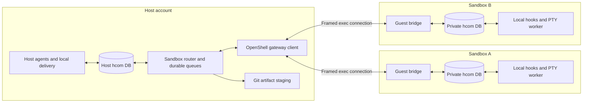

# Design

## Context

See [proposal.md](proposal.md) for motivation and the three capability deltas for the behavioral contract. This is a researched design, not an implemented or live-qualified integration.

Research was limited to this hcom checkout, Git objects at its recorded upstream base, the requested `OpenShell-current` checkout, and primary OpenShell documentation. No historical plans or isolation implementations from other hcom folders were consulted.

### Evidence and resulting constraints

| Evidence checked on 2026-10-23 | Consequence |
| --- | --- |
| hcom HEAD `d04da5f`; `docs/fork-patches.json` records upstream `de33e31a0cdbba4c5863f7cc050d8b79aa50bcdf` | Use that exact base for the first portability trial; this is not a claim about current upstream HEAD. |
| `src/commands/launch.rs` and `src/launcher.rs` have stable upstream launch boundaries; `LaunchBackend` distinguishes visible PTY, headless PTY, and native print hosting | Add execution location orthogonally; do not replace backend or tool abstractions. Dispatch sandbox selection before host tool validation/configuration. |
| `src/integration_spec.rs` already assigns `--sandbox` to several tools | Reserve `--hcom-sandbox <profile>` and `--hcom-sandbox-source <commit>` for hcom. Test `--` and value forwarding. |
| `src/launcher.rs::build_launch_env_with_resolver` inherits ambient shell environment and hcom env extras | Never send its host result wholesale to a guest. Resolve guest settings from an explicit profile. |
| `src/commands/send.rs`, `src/messages.rs`, and `src/db/events.rs` implement routing, envelopes, inbox cursors, and generation keys | Reuse their local behavior through narrow adapters. The bridge observes its own queues, not the agent inbox cursor. |
| `src/commands/events/result.rs::apply_result_correlation` accepts the expected generation's `inform` in a thread | Sandbox result waits need an explicit final marker and request identity; ordinary informs retain their existing behavior. |
| `src/instances.rs` treats any `origin_device_id` as remote; `src/instance_lifecycle.rs` deletes stale remote rows using MQTT sync keys | Foreign-instance projection can be reused only with explicit transport classification and sandbox-owned cleanup. Setting the origin field alone is incorrect. |
| `SECURITY.md` documents all-or-nothing PSK relay authority; `src/relay/control.rs` exposes launch, kill, config, terminal, events, and subscription RPCs | Guests must not join the trusted relay. Capability advertisements are not authorization. |
| `src/relay/push.rs` exports local state and may shrink oversized events; its exclusions do not describe a sandbox team | Explicitly exclude sandbox-scoped events from MQTT export. Do not use snapshot shrink/backfill as the durable result transport. |
| `src/commands/events/{observation,result}.rs` and `src/db/fork_schema.rs` do not exist at the recorded upstream base | Keep fork progress/result adapters separate. The new core must not depend on these files or the approval-owner extension. |
| OpenShell checkout `a24340bebaa9ee173725ce87c48011d2cc2cacd9` has an existing local VM-driver modification | Preserve that work. No OpenShell changes are included here. |
| PATH CLI reports `0.1.3`; checkout CLI and gateway report `0.1.6-pre.1` | Store the absolute executable and gateway identity in the profile; probe behavior, not just semver. |
| `crates/openshell-cli/src/run.rs` streams open piped stdin after a 200 ms grace and caps cumulative piped input at 4 MiB | A persistent exec bridge needs controlled rotation below that limit. EOF is not permission to discard pending output. |
| `run.rs::sandbox_exec_streaming_grpc` writes and flushes stdout/stderr chunks, keeps reading after Exit, and fails on missing Exit or failed final status; sandbox overview documents slow-reader backpressure and output-drain failure | Guest-to-host output is a streamed, backpressured direction, not the 4 MiB stdin allowance. Concurrent draining, bounded application credit, slow-reader recovery, and final-status checks need their own live qualification. |
| `src/delivery.rs::inject_text` strips C0 controls except tab but permits characters above that range; wake previews use sanitized metadata | Do not claim complete terminal-control safety from the PTY helper. Validate guest text and identifiers before any inbox/rendering path, including C1 and DEL rejection. |
| OpenShell sandbox overview rejects creation-time `--upload` with a main command | Create a retained scratch sandbox, transfer inputs, then launch the detached guest worker. Sandbox main-process attachment is not the worker's PTY. |
| OpenShell runtime docs select one compute driver per gateway; VM binds have additional host exposure | A profile selects and verifies a gateway with the intended driver. The reference profile has no host bind mounts. |
| Runtime docs state that VM `--cpu`/`--memory` requests do not change allocation | Qualify the gateway's VM `vcpus`/`mem_mib` configuration; passing generic create flags is not evidence of resource enforcement. |
| OpenShell provider profiles bind credentials to endpoints; no-login exec still needs a controlled environment | Attach explicit provider instances, including custom endpoint profiles when needed; clear shell startup injection variables for managed bridge exec. |

Primary references, checked alongside the local source:

- [Sandbox exec, input limits, upload, and lifecycle](https://github.com/NVIDIA/OpenShell/blob/a24340bebaa9ee173725ce87c48011d2cc2cacd9/docs/how-it-works/sandboxes/overview.mdx); [current upstream documentation](https://github.com/NVIDIA/OpenShell/blob/main/docs/how-it-works/sandboxes/overview.mdx).
- [Runtime selection and VM mount limitations](https://github.com/NVIDIA/OpenShell/blob/a24340bebaa9ee173725ce87c48011d2cc2cacd9/docs/how-it-works/sandboxes/runtimes.mdx).
- [Provider endpoint binding](https://github.com/NVIDIA/OpenShell/blob/a24340bebaa9ee173725ce87c48011d2cc2cacd9/docs/how-it-works/providers/profiles.mdx).

Graph coverage checks reported no recorded gaps for the source paths above; material behavior was checked in exact source. Coverage remains a best-effort signal. The CLI versions/help and source were checked live, but no gateway was started and no agent or transport was live-qualified during planning.

## Goals / Non-Goals

**Goals:** Keep normal hcom conversations and local tool delivery across an execution boundary; make accepted traffic and results survive bridge failures; enforce guest scope independently of guest honesty; give upstream ports a small, identifiable adapter surface.

**Non-Goals:** No general remote-execution framework, scheduler, new agent language, custom OpenShell compute driver, or replacement for Git. No initial guarantee for desktop-backed Antigravity, Windows/macOS hosts, every CLI provider, multi-worker guests, uncommitted snapshot capture, or remote MQTT-to-sandbox forwarding. See the proposal for the release scope.

## Decisions

### 1. Host-owned router, private guest hcom, one worker per sandbox

The router is ordinary host code, not a coordinating model. Each guest runs the same qualified hcom bridge protocol plus an existing local CLI/PTY integration against a private `HCOM_DIR`. The host owns team membership, canonical aliases, routing identities, and lifecycle records.

A sandbox launch batch creates a fresh team containing the explicitly resolved host requester and that batch's workers. Host-only team management can enroll additional host agents, and `--hcom-sandbox-team <id>` can place a later batch into an existing authorized team. An external launcher without a host agent identity receives a controller handle rather than an invented host-agent identity. Tags and thread names are routing conveniences, not authorization credentials. Guests cannot enroll peers or expand a team by naming a new target.



The gateway authenticates host-initiated connections. No host listener, MQTT PSK, or gateway client credential is provided to guests. A compromised guest can corrupt its own reports or send authorized team messages; it cannot turn a frame into a host control request. Messaging still exposes host agents to untrusted peer content, so attribution and existing host execution permissions remain necessary.

**Alternative:** Shared host `HCOM_DIR` or trusted relay enrollment is simpler to connect but grants filesystem or control authority beyond messaging. A newly exposed network broker would require another authentication/authorization surface. Neither is needed for the first mode.

### 2. Separate location selection from guest tool behavior

Proposed launch surface:

```sh
hcom claude --hcom-sandbox coding --headless --dir /path/to/repo --go
```

`coding` is an operator-owned entry in `$HCOM_DIR/sandbox-profiles.toml`. It references an absolute OpenShell executable, gateway and workspace, expected driver, pinned image, policy file, provider names, explicit non-secret env, repository input policy, resource/timeout bounds, and guest unattended tool arguments. Store identifiers and digests in run records; never embed provider secrets in the profile or CLI arguments.

Host launch parsing validates combinations before tool-specific host preparation. Sandbox mode removes its own options, serializes raw tool arguments, and asks guest hcom to perform normal tool setup at guest paths. The bridge uses absolute executable paths and argument vectors; no guest data is interpolated into host shell commands. Host env files, terminal context, and host trust settings are not guest defaults.

The reference tool is Claude Code's existing live PTY mode, including for headless launches. Do not force print/Agent SDK mode or a provider/model change. A qualified profile supplies its guest-only unattended permission setting. OpenShell policy proposal approval remains operator-controlled; the profile must not enable automatic boundary expansion to avoid tool prompts.

Guest roles do not start the host sandbox router or trusted relay worker. The role marker is a behavior setting, not a security credential. Unsupported desktop/nested/cross-device combinations fail before provisioning; adding another tool or runtime requires a bounded qualification record.

The first release requires `--headless` and rejects visible launch, `--run-here`, and explicit `--terminal` options before provisioning. Existing configured host terminal preferences are not applied to a guest. A count of N creates N independently owned sandboxes in one team, with per-worker success/failure handles and retention of partial provisioning evidence. A later visible attach implementation needs its own qualification; observation does not imply interactive launch support.

**Alternative:** A `hcom run` wrapper can prototype transfers but cannot transparently integrate names, inboxes, lifecycle, and authorization. Replacing `LaunchBackend` with a sandbox variant conflates location with PTY/print hosting.

### 3. Bootstrap a scratch sandbox, then a detached worker

Preflight verifies executable capabilities, gateway identity and driver, effective policy, image availability, required guest hcom/tool versions, and provider bindings. Explicit providers and disabled automatic credential discovery avoid copying host credentials. Refuse bind mounts in the reference profile. Keep the configured gateway's normal authenticated TLS checks.

For source input, create a Git bundle for the selected base and its reachable prerequisite history, not all refs or a copy of `.git`. Clone it inside the guest with fresh configuration and hooks. That history is part of the selected repository input; omit unrelated refs, worktree metadata, remotes with credentials, host hooks, and Git config. Dirty or untracked local work requires explicit `--hcom-sandbox-source <commit>` acknowledgment of committed-only input. Capturing dirty work is not implemented by this first mode.

Create a retained detached scratch sandbox without a workload main command or automatic deletion. Upload inputs to a fixed staging area and initialize the snapshot before starting the worker with guest hcom's detached PTY launch. Use `sandbox exec --no-tty --no-login-shell` for managed commands, with controlled env including `BASH_ENV` and `ENV` neutralization. Agent and bridge state live outside the mutable repository snapshot. Guest process detachment and survival across exec disconnect are a mandatory live qualification gate, not an assumption based on Ready status.

Readiness progresses through `provisioned`, `inputs-ready`, `bridge-ready`, and `agent-ready`. A ready scratch shell is not a ready agent. Failures retain the captured sandbox ID, phase, command outcome, and bounded logs. The bridge exec process is not the worker supervisor: rotating it must not recreate the worker.

### 4. Use framed exec with durable replay and connection rotation

Use the OpenShell CLI as the initial transport adapter. This keeps OpenShell's Rust SDK and its dependency tree out of hcom and permits capability probes against the selected executable. A raw SDK/SSH transport remains a future substitute behind the adapter if measured limits require it.

The host starts a fixed guest bridge command over non-TTY exec. Stdout contains only length-delimited versioned JSON frames; stderr is bounded diagnostics. The parser rejects oversized length headers before allocation, malformed frames, unsupported protocol versions, unknown kinds, invalid UTF-8/field types, and unexpected identities.

Protocol kinds cover handshake/directory snapshots, outbound message requests, routed inbox messages, durable acceptance, observed delivery receipts, bounded activity, result submissions, and connection close. No generic RPC, SQL, shell command, file-read, or host control frame exists. Each message carries a stable origin key, sequence, thread/reply references, payload digest, and host-issued location/team binding. Transport epoch is separate from message identity so reconnects can replay the same message.

Initial implementation defaults: maximum encoded frame 256 KiB, conservative host-to-guest exec rotation at 2 MiB including framing and acknowledgments, and a bounded connection lifetime. The 4 MiB source observation is not a runtime capability API. A qualification probe records the actual input allowance for the exact CLI/gateway/runtime fingerprint; preflight requires that qualified record to match. Unknown allowances or an allowance below 2 MiB plus a maximum frame and reserved control margin fail qualification. The recorded allowance feeds the byte guard; it must never be inferred from semver alone.

The configured rotation point (initially 2 MiB) is the guard threshold: rotate before a new payload frame would cross it. The measured allowance is a separate upper safety bound with control/drain headroom, not a second competing rotation target. Oversized sandbox messages fail explicitly at the sender before queue acceptance, including a host sender whose normal local message limit is larger. Large evidence uses Git artifacts. Durable queue byte/count limits and expiry are explicit profile limits; an expired message emits terminal delivery failure instead of being silently dropped.

Drain exec stdout continuously in a separate reader from the input writer. Guest-to-host frames have a bounded outstanding credit window; the host grants more credit only as its parser/admission path consumes them. Slow-reader tests must demonstrate bounded buffering, clean recovery, and no false acceptance. A stalled output or final-status drain closes/fences the connection at a bounded deadline and replays unacknowledged frames. Do not assume an unlimited or infallible output channel merely because its inspected loop has no cumulative-input-style counter.

Admission also enforces per-guest pacing, finite per-run and per-team cumulative message-count/byte budgets, and a host-wide storage ceiling. These cover accepted inbox/history rows as well as pending queues; successful forwarding does not replenish a run's history budget. Bound activity/diagnostic storage separately and coalesce replaceable status. Persist counters in the same transaction as acceptance, so reconnect/restart cannot reset credit. Budget renewal is host-only. Reserve a small bounded control allowance for receipts/close/errors to avoid a payload-credit deadlock, and emit at most a bounded rejection diagnostic before fencing a flooding connection. Defaults are finite in the reference profile; an unlimited guest budget is invalid.

At host admission of each assigned request, reserve one terminal-report slot of at most 64 KiB encoded bytes against the run/team/host ceilings. If that reservation cannot be made, reject the new request before execution. Ordinary progress cannot spend this reservation. A valid correlated final can consume it even after ordinary payload/history credit is exhausted; duplicate replay consumes nothing extra. Results exceeding the terminal-report bound must move detail into an artifact and use a bounded summary. Forged, malformed, unrelated, or conflicting finals cannot acquire new reservation credit. Artifact transfers have their own finite byte quotas; report admission does not override a failed artifact handoff.

On rotation, stop sending new frames, persist/drain available acknowledgments, close stdin, and read stdout plus final command status with a bounded drain deadline. Replay unacknowledged frames on the replacement. A persisted owner lock and monotonically increasing connection epoch fence old writers, with guest handshake validation. Takeover does not depend solely on wall-clock lease expiry. Network failure follows the same replay path; no operation assumes EOF proves remote execution did not occur.

The first live transport probe must exceed 4 MiB in each direction, establish the input budget used by the guard, deliberately slow/stall the host stdout reader, kill a connection between receive-commit and ack, and interrupt the host router. If the CLI does not support this contract, stop that implementation phase with evidence rather than quietly substituting an unqualified transport or editing OpenShell.

### 5. Keep acceptance, delivery, and results in durable additive storage

Use sandbox-namespaced tables in the existing local SQLite database, initialized idempotently only for opted-in sandbox participation. Keep these tables separate from upstream migration numbering and from `db/fork_schema.rs`:

| State | Purpose |
| --- | --- |
| Runs and agent bindings | Gateway/workspace/sandbox ID, team, host-issued generation and aliases, profile/input digests, lifecycle and connection observations |
| Inbox/outbox ledger | Stable origin/incarnation/sequence, immutable payload digest, next-hop acceptance and retries |
| Local event mapping | Stable bridge identity to local hcom event ID and reply reference |
| Requests and results | Assigned worker/request/thread, submitted report, artifact availability, terminal outcome and provenance |

For messages involving sandbox routing, queue acceptance and the local message event commit together. Inbound dedup state, event mapping, and inbox insertion also share one transaction. Publish wakes and subscription effects after commit. Observers/exporters have their own cursor; they never call agent inbox consumption APIs to obtain traffic. Existing local hooks/PTY code records actual context delivery. A guest adapter exports that evidence, not timestamp-derived read inference.

Transport promises retry with deduplicated inbox insertion, per-sender ordering, and visible unresolved failure. It does not promise exactly-once model actions. Database replacement/incarnation mismatch fails closed until explicit reconciliation or a new run generation is created. Do not reuse source event numbers across database resets.

**Alternative:** A separate router SQLite file would simplify module ownership but cannot atomically commit its dedup state with hcom inbox insertion. Namespaced tables give the necessary atomicity without taking over upstream migrations.

The host controller is a detached internal `hcom sandbox-worker` process with one owner per `HCOM_DIR`, a captured executable/PID incarnation, and a heartbeat. A sandbox launch enables autostart and ensures ownership before reporting success. An authorized sandbox-targeted send commits its queue record even when the controller is absent, reports pending forwarding, and lazily starts/adopts an enabled controller under the ownership lock. Host management activity can also restart it; status-only reads observe state without starting it. No per-command agent identity or terminal handles are inherited into the controller.

On controller crash, the next eligible host action validates stale ownership, takes a new epoch, reconciles owned sandboxes, and resumes queues without relaunching guest workers. Closing the launching terminal has no effect on the detached controller. A clean controller-stop command disables autostart, stops new writes, drains bounded transport work, saves cursors, releases ownership, and leaves guests/queues retained. Later status reads and local messages keep working; sandbox sends remain visibly pending until an explicit enable/start. The controller exits after a bounded idle interval only when no live runs or pending transport work remain. For this predicate, provisioning, running, and connectivity-unknown owned resources are live; gateway-confirmed stopped or terminal resources are not. Unexpired queue entries and resumable artifact work remain pending even if their destination is stopped. Retained terminal records alone do not keep the process alive. No system service is installed by this change, so a crash with no subsequent host activity leaves forwarding pending until restart; there is no unsupported continuous-availability claim.

### 6. Reuse foreign-instance presentation with explicit transport classification

Each run gets a host-reserved realm and collision-checked short alias. Reuse hcom's foreign-name presentation where compatible, but store authoritative full location/generation keys in the sandbox binding table. Guest messages do not get to supply `_relay`, host sender keys, instance creation timestamps, local PIDs, notification endpoints, transcript paths, capabilities, or lifecycle authority.

Project sandbox peers into normal instance discovery as foreign rows, tied to the binding table. A single location resolver classifies `local`, `trusted-relay`, and `openshell` before routing control operations. Any synthetic `origin_device_id` is a presentation aid, not proof of MQTT membership. Stale MQTT cleanup skips sandbox bindings; sandbox cleanup owns them. No guest PID is treated as a host PID.

Inside each guest, import only the assigned team's sanitized peer directory. Rewrite canonical targets, reply references, and local event IDs through the host's map, preserving origin identity across hops. Resolve broadcasts and subscriptions within that team. Messages spanning incompatible team/relay scopes are rejected before acceptance rather than being implicitly widened. A host broadcast without sandbox-team context does not enroll all sandboxes.

Mark sandbox-scoped host messages and imported guest events at creation. Exclude them from trusted MQTT state/event exports and backfill, including host-origin messages addressed into a sandbox team. Do not rely only on `_relay` loop prevention: that marker has different trust and routing semantics. Test coexistence with the ordinary relay enabled.

Host-directed status, stop, start/resume, bounded logs/transcript, and supported terminal view use a controller operation bound to captured ownership. Guest protocol parsing never calls the host control dispatcher. Unsupported views return explicit errors. The first release does not expose guest-defined subscription SQL or transplant guest transcript paths into host readers.

The compliant guest send adapter escapes prohibited C0/C1/DEL characters into visible `\uXXXX` notation before assigning the canonical payload digest or durably enqueueing it; newline and tab remain unchanged. It reports that normalization to the caller, and rejects invalid identifiers instead of normalizing them. This makes routine terminal-derived text submit safely without asking a model to discover and remove ANSI bytes manually.

Independently reject any raw guest frame text still containing C0/C1 controls or DEL, except ordinary newline and tab, before inbox insertion. Identity/metadata fields use stricter bounded schemas. This preserves multiline code while keeping ESC/OSC sequences, carriage-return/key controls, BEL, and C1 sequences out of host message rendering and PTY paths. Rejection is explicit and consumes no recipient inbox slot. Existing local message handling is unchanged; ordinary local PTY sanitization is an additional layer, not the guest trust boundary.

### 7. Explicit terminal results, ordinary conversations, Git for payloads

Extend the send envelope additively for a structured final result (proposed `hcom send --result completed|failed|cancelled`, used with request/reply/thread information). Preserve `request`, `inform`, and `ack` conversation semantics. A final report includes a stable result ID, assigned request and worker generation, summary, validation claims, and artifact descriptors. Progress can remain ordinary `inform` without the result marker.

`--result` implies `inform`; an explicit contradictory intent, missing thread/request reference, or unknown request is rejected. The host creates the initial-prompt request record before guest execution and gives the assigned reference to the worker bootstrap. Later request messages create their assignment records at acceptance. Guest result data cannot invent or reassign requests. Resuming into a new worker generation does not silently retarget old result waits.

The portable controller owns a strict request/result ledger and a sandbox result-wait command. In this checkout, a small separate adapter makes `events --result-from` use the strict rule for sandbox bindings and leaves ordinary workers unchanged. It must not infer completion from an idle event, a transport ack, or the first inform. The portable core does not import `core::result_wait`, compact stream helpers, or provider transcript-recovery code.

Default artifact route is a Git bundle collected by the host through fixed sandbox staging paths. Validate repository binding, base prerequisites, object identity/integrity, declared size/digest, and containment before importing into an isolated bare staging repository. The collector uses a clean Git configuration and disabled hooks/helpers/replace refs; no guest config, hook, remote URL, or repository checkout is executed. Network retrieval is limited to operator-declared routes, never arbitrary guest URLs. Bundle validation establishes availability/integrity, not correctness.

An accepted report and artifact availability are separate states: `report-submitted -> report-durable -> artifacts-pending/ready/failed -> terminal-handoff`. Analysis-only tasks explicitly declare no artifacts. Required transfer failure cannot publish a completed handoff; retain the report and retry or report a handoff failure. Identical result replay is idempotent; a differing terminal report for the same request/generation is a visible conflict.

Authorized sandbox peers can request known artifact transfer IDs. The host copies verified Git objects into the recipient guest's staging repository; it does not run a guest-selected host command or act as a general file server. Host worktree application remains a separate deliberate workflow action. Validation claims retain worker/commit/environment provenance, and later host checks are separate records.

### 8. Lifecycle and cleanup preserve unresolved work

Record gateway, workspace, immutable sandbox ID, worker generation, profile/input digest, and connection epoch before publishing a launch handle. Re-resolve the ID and verify ownership before every operation, even if the OpenShell CLI requires a name argument. Never operate on a reused display name without ID validation.

Maintain independent gateway lifecycle, bridge connectivity, and guest activity observations. `disconnected` does not imply stopped. `kill`/stop maps to an owned sandbox operation and preserves run metadata; start/resume reconnects to retained storage and validates the worker/session state rather than blindly starting a second worker. Reject unsupported restoration explicitly. A confirmed stopped worker without a report yields a missing-result outcome; host filesystem transcript recovery is not a fallback.

Default retention keeps the sandbox and evidence until final reports and required artifacts are safe on the host. There is no `--no-keep` shortcut. Explicit destructive discard can remove unresolved guest data only when the command clearly reports that loss and is authorized through the host path. Poll asynchronous deletion by captured ID with a bounded timeout; an accepted delete is not confirmed cleanup.

### 9. Prefer a portable core and separate downstream adapters

Proposed ownership (exact filenames can be refined without changing the contracts):

| Boundary | Ownership |
| --- | --- |
| `src/sandbox/{profile,protocol,store,router,openshell,lifecycle,results,artifacts}.rs` | New optional feature logic and schema; no OpenShell crate dependency |
| Launch/router entry points | Recognize namespaced options and management commands; branch before host preparation |
| Message/event boundary | Atomic sandbox enqueue/import, stable ID mapping, post-commit wake, additive result envelope |
| Location resolver and peer projection | Classify transport, exclude sandbox state from MQTT cleanup/export, route host-only management |
| Fork-only progress/result adapter | Integrate compact observation and `--result-from` without making them core prerequisites |

Keep commits separable as `sandbox-core`, `sandbox-openshell`, and `sandbox-fork-integration`, with explicit dependency trailers and focused checks. These are proposed patch IDs; they do not update the manifest in this planning pass. Validate the core plus required shared hooks against the recorded pristine upstream base in a temporary source snapshot, using Git objects from this repository. Do not consult other hcom plans. If this needs extra shared changes, record their exact contracts rather than hiding dependencies or forcing a broad abstraction solely to reduce conflicts.

The existing manifest's "No isolation implementation" statement describes the current retained series. Implementation must narrowly amend that scope for this authorized new mode, preserving the prohibition on importing historical isolation code. Keep previous patch ownership intact. An independently applicable small series is a preference, not a condition that overrides correct communication, containment, or result handling.

## Risks / Trade-offs

- [Guest messages can influence host agents] -> Treat content as peer input; host-only transport control is denied, but semantic prompt injection remains a host-agent permission concern. Do not claim messaging alone eliminates it.
- [Authorized guest floods valid messages or status] -> Enforce pacing and cumulative per-run/team/host admission budgets before durable growth, including delivered history and diagnostics; preserve bounded control credit and report quota failure.
- [Detached controller crashes without new host activity] -> Queues remain durable and connectivity stays pending; lazy restart occurs on eligible activity or explicit start. An OS service is not silently installed to promise continuous availability.
- [CLI exec is a bounded stream and shutdown can be ambiguous] -> Rotate below the measured limit, drain output, fence connections, persist IDs and acknowledgments, and qualify replay under fault injection before adding launch UX.
- [Current remote representation assumes MQTT in several places] -> Use explicit location classification and coexistence tests. Reusing names must not reuse trusted-relay authorization, cleanup, shrink, or timestamp receipt rules.
- [Guest can forge its own status or validation claims] -> Host assigns identity, gateway confirms resource lifecycle, and reports retain provenance. Host revalidation remains separate.
- [Shared database transactions can affect ordinary delivery] -> Enter new write scopes only for sandbox routes, publish effects after commit, and run the existing message/observation suites.
- [VM persistence and process detachment vary by runtime/version] -> Initial acceptance is tied to the selected Linux VM stack and a live disconnect/stop/start trial, not a universal durability claim.
- [Committed snapshot can omit the user's work] -> Require explicit committed-only selection for dirty sources and record exclusions. Do not add an implicit dirty snapshot format in implementation.
- [Git artifacts may contain hostile metadata or unexpected history] -> Bundle only selected inputs/outputs; validate in bounded bare staging with controlled Git settings, no imported hooks/config, and no automatic host checkout or execution.
- [More adapter hooks may be needed than a single cherry-pick] -> Keep the exact diff/dependencies visible and measure with an isolated upstream application/build trial. Correctness takes precedence over an artificial patch-count target.

## Migration Plan

1. Implement and qualify the bounded protocol/storage/authorization path before integrating unattended agent launch. This phase uses controlled guest endpoints; no production relay enrollment or host permission changes.
2. Add optional profile and launch integration. Build a pinned guest image and record the host CLI, gateway, guest runtime, hcom protocol, and tool versions. Import credentials and configure a gateway only within separately authorized operational scope.
3. Run one host and two VM guest workers through conversation, reconnect, final-result, and Git handoff scenarios. Preserve failures and raw provenance; include an idle-recipient wake and a byte-budget rotation.
4. Run focused and complete appropriate Rust quality gates, existing fork contract checks, and independent review. Publish limitations for untested platforms and providers. Do not install or publish a release as part of this change without authorization.
5. Roll back by stopping the sandbox controller and routing new work locally. Keep ordinary hcom data intact; retain sandbox-namespaced tables and captured IDs for later collection/cleanup. Downgrading must not turn guest projections into local process handles. Remove owned guest resources only after collection or an explicit discard.

## Open Questions

Only qualification inputs remain to be filled during apply: the operator's reference image digest/provider names, resource limits appropriate for the local machine, and bounded connection/queue timeouts. They do not change the protocol, authorization boundary, source snapshot policy, or task order. Record concrete values in the live qualification evidence; do not hardcode workstation paths or credentials into portable defaults.
